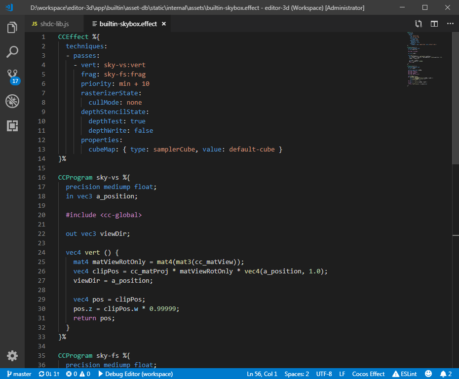

# Cocos Effect

> 🌐 [English Documentation](./README.md)

为 VS Code 提供 Cocos Creator `.effect` / `.chunk` 文件的完整语言支持。



---

## 功能一览

| 功能 | 说明 |
|---|---|
| 语法 / 语义高亮 | CCEffect YAML 块、CCProgram GLSL 块、`#include` 路径分色显示 |
| 诊断报错 | 调用引擎内置 `effect-checker` 编译校验，Problems 面板实时显示错误 |
| CCEffect YAML 校验 | 静态检测字段名拼写、枚举值合法性、必填字段缺失 |
| 跳转定义 | `F12` / `Ctrl+Click` 跳转到 `#include` 对应的 chunk 文件 |
| 自动补全 | GLSL 内置函数/宏/变量、`#include` 路径、CCEffect YAML 字段 & 枚举值 |
| 悬停提示 | 函数签名、变量类型、内置符号说明 |
| 签名帮助 | 调用函数时显示参数列表 |

---

## 快速上手

### 第一步：安装依赖扩展

本插件需要配合 [Shader languages support for VS Code](https://marketplace.visualstudio.com/items?itemName=slevesque.shader) 使用，请先在扩展市场安装。

### 第二步：配置引擎路径

打开 VS Code 用户设置 JSON（`Ctrl+Shift+P` → **Preferences: Open User Settings (JSON)**），加入以下配置：

```jsonc
// 填写你本机的 Cocos Creator 引擎根目录路径
"cocos-effect.enginePath": "D:\\Work\\cocos\\cocos4"
```

> **支持两种路径格式：**
> - 引擎源码根目录（含 `package.json` 且有 `editor/assets/chunks/` 子目录）
> - Cocos Creator 安装目录（插件会自动定位内部引擎路径）

配置完成后，重新打开任意 `.effect` 文件即可生效，无需重启 VS Code。

---

## 功能详解

### 语义高亮

| 颜色语义 | 含义 |
|---|---|
| 蓝色 | `#include` 路径、命名空间 |
| 橙色 / 黄色 | 宏（`#define`、`#ifdef` 等） |
| 紫色 / 品红 | 关键字（`uniform`、`attribute`、`varying` 等） |
| 绿色 | 枚举值 |
| 浅蓝 | 内置函数 |

### 诊断报错（Problems 面板）

插件在**打开**或**保存** `.effect` 文件时自动触发两套检查：

1. **Effect Checker**：调用 `<引擎>/native/external/win64/bin/effect-checker/effect-checker.exe` 进行完整编译，将编译错误精确定位到 effect 文件对应行。
2. **YAML 静态分析**：无需编译，直接检测 CCEffect YAML 块中的常见错误：
   - `techniques` / `passes` 结构缺失
   - pass 缺少 `vert` / `frag`
   - `blendSrc`、`depthFunc`、`cullMode` 等枚举值拼写错误
   - `properties.target` 格式非法

> 注意：`.chunk` 文件不单独编译，诊断以 `.effect` 文件为入口。

### 跳转定义（Go to Definition）

将光标放在 `#include <builtin/uniforms/cc-global>` 的路径部分，按 `F12` 或 `Ctrl+Click` 即可跳转到对应 chunk 文件。

同样支持跳转到 `.effect` 文件内 `CCProgram` 的定义处。

### 自动补全

| 触发场景 | 补全内容 |
|---|---|
| `#include <` 或 `#include "` | 引擎 chunks 目录下所有 `.chunk` 路径（自动去除 `.chunk` 后缀） |
| CCEffect YAML 字段位置 | 当前上下文的合法字段名（pass / blendState / depthStencilState 等） |
| CCEffect YAML 值位置 | 枚举合法值（如 `blendSrc: ` 后列出全部 BlendFactor） |
| CCProgram GLSL 块内 | 引擎内置函数、宏、变量、GLSL 关键字 |

---

## 已知限制

- 诊断功能仅支持 **Windows**（effect-checker.exe 目前只有 Win64 版本）
- 首次打开文件时诊断需要数秒（effect-checker 编译耗时）
- 相对路径 `#include` 跳转依赖当前文件所在目录

---

## 相关链接

- [Cocos Creator 用户手册](https://docs.cocos.com/creator/manual/)
- [Cocos Effect 语法参考](https://docs.cocos.com/creator/manual/zh/shader/)

---

## 更新日志

### 0.5.0

- **新增** Phase 1：接入引擎 effect-checker，打开/保存时自动诊断报错
- **新增** Phase 2：`#include` 跳转定义（F12 / Ctrl+Click）
- **新增** Phase 3：CCEffect YAML 字段静态校验（字段名、枚举值、必填项）
- **新增** Phase 4：增强自动补全（#include 路径、YAML 字段 & 枚举值、GLSL 符号恢复）
- **修复** `#include` 路径语义高亮（缩进、首行覆盖）

### 0.4.3

Bug 修复

### 0.4.2

移除 cocos 补全提供器，改用默认补全提供器。

### 0.4.0

新增语义高亮与语言服务器。

### 0.3.0

添加插件图标。

### 0.2.0

新增 `.chunk` 文件支持。

### 0.1.0

修复嵌入语言支持，注释在不同块中均可正常工作。

### 0.0.1

初始版本，提供基础语法高亮。
